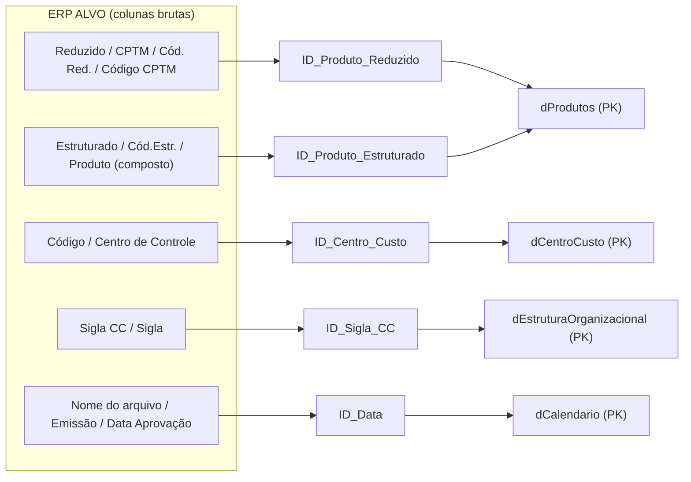

# 🔑 MVP II — DICIONÁRIO DE COLUNAS `ID_*` E RASTREABILIDADE DE CHAVES

> **Projeto:** Business Intelligence para Gestão de Estoque e Suprimentos — CPTM (ERP ALVO)  
> **Etapa:** MVP II — Engenharia de Chaves, Dicionário de Dados e Auditoria de Integridade  
> **Instituição:** FATEC Logística • 4º Semestre • Disciplina API IV • Prof. Newton

---

## 📌 1. O que é este MVP

O [MVP I](./MVP_I.md) entregou o pipeline de ETL e o modelo Star Schema. Este MVP II **abre a "caixa-preta" das chaves de ligação**: documenta, coluna por coluna, de onde cada `ID_*` nasceu no ERP ALVO, qual regra de transformação o script `etl_cptm_powerbi.py` aplicou e qual papel a chave cumpre no modelo.

O resultado é um **dicionário de rastreabilidade** que permite a qualquer pessoa da equipe (ou da CPTM) responder, para qualquer coluna `ID_*` da pasta `Processados_PowerBI`:

- **De qual arquivo e coluna do ERP ela veio?**
- **Que tratamento foi aplicado?**
- **É chave primária, estrangeira ou auxiliar?**
- **Com qual tabela ela se conecta, e com que taxa de correspondência?**

> 💡 **Como usar este documento:** a seção 3 é uma consulta rápida (matriz única); a seção 4 detalha cada tabela; a seção 5 explica as funções Python por trás das regras; a seção 6 apresenta a auditoria que comprova o resultado.

---

## 🧩 2. Por que foi necessária uma engenharia de chaves

Os relatórios do ERP ALVO apresentavam inconsistências típicas de sistemas legados de grande porte. Cada uma delas motivou uma decisão específica no ETL:

| Problema encontrado no ERP | Exemplo real | Solução adotada |
| :--- | :--- | :--- |
| **Nomenclatura discrepante** | O mesmo código de material se chama `Reduzido` (cadastro), `CPTM` (RES43), `Cód. Red.` (RES34) e `Código CPTM` (RES75) | Unificação em uma única coluna: `ID_Produto_Reduzido` |
| **Zeros à esquerda perdidos** | `'084467'` lido como `84467.0`; `'000033'` lido como `33` | Tratamento estrito como texto de 6 dígitos (`zfill(6)`), preservando alfanuméricos como `'E006054'` |
| **Máscara de pontos nos centros de custo** | `'1.10.00.0.0'` interpretado pelo Power Query como número decimal | Tratado como texto imutável e exportado em Parquet, que preserva o tipo |
| **Caracteres ocultos e textos compostos** | `\n`, `\r`, tabulações; `'1.03.01.01.00013-7 - PARAFUSO...'` | Rotinas de `strip` e `split` para isolar apenas o código |
| **Chaves sem visibilidade** | Colunas de ligação espalhadas no meio de dezenas de campos | `reordenar_colunas_id()` leva todas as `ID_*` para as primeiras posições |

---

## 🗺️ 3. Matriz consolidada de rastreabilidade

Visão única de **todas** as colunas `ID_*` geradas. Legenda do tipo de chave: **PK** = chave primária (lado 1) · **FK** = chave estrangeira (lado N) · **FK Aux.** = estrangeira auxiliar (não usada em relacionamento ativo, mantida para análise e conferência) · **Secundária / Atributo** = identificador adicional da dimensão.

| Tabela Destino | Tipo | Coluna ID Criada | Arquivo de Origem (ERP) | Coluna de Origem | Chave | Regra de Transformação |
| :--- | :--- | :--- | :--- | :--- | :--- | :--- |
| `dCalendario` | Dimensão | `ID_Data` | Gerada dinamicamente | `pd.date_range` (2014–2030) | PK | `strftime('%Y-%m-%d')` |
| `dProdutos` | Dimensão | `ID_Produto_Reduzido` | `1. PROD__20260824.xlsx` | `Reduzido` | PK | `formatar_codigo_reduzido` (6 dígitos / `zfill`) |
| `dProdutos` | Dimensão | `ID_Produto_Estruturado` | `1. PROD__20260824.xlsx` | `Estruturado` | Secundária | `formatar_texto_limpo` (`strip` / remoção de `\n`) |
| `dEstruturaOrganizacional` | Dimensão | `ID_Sigla_CC` | `0. Estrutura Organizacional_20260824.xlsx` | `Sigla CC` | PK | `formatar_texto_limpo` + desduplicação (159 siglas) |
| `dEstruturaOrganizacional` | Dimensão | `ID_Centro_Custo` | `0. Estrutura Organizacional_20260824.xlsx` | `Código Estruturado` | Atributo | `formatar_texto_limpo` |
| `dCentroCusto` | Dimensão | `ID_Centro_Custo` | `3. Centro de Custo_20260824.xlsx` | `Código` | PK | Preservação da máscara com pontos (`'1.10.00.0.0'`) |
| `dCentroCusto` | Dimensão | `ID_Sigla_CC` | `3. Centro de Custo_20260824.xlsx` | `Sigla` | FK | `formatar_texto_limpo` (liga 1:N com `dEstruturaOrganizacional`) |
| `fPlanejamento_RES43` | Fato | `ID_Produto_Reduzido` | `2. RES43_*_20260824.xlsx` (3 arquivos) | `CPTM` (`skiprows=1`) | FK | `formatar_codigo_reduzido` |
| `fPlanejamento_RES43` | Fato | `ID_Produto_Estruturado` | `2. RES43_*_20260824.xlsx` (3 arquivos) | `Cód.Estr.` (`skiprows=1`) | FK Aux. | `formatar_texto_limpo` |
| `fPlanejamento_RES43` | Fato | `ID_Centro_Custo` | `2. RES43_*_20260824.xlsx` (3 arquivos) | `Centro de Controle` | FK Aux. | `formatar_texto_limpo` |
| `fPlanejamento_RES43` | Fato | `ID_Data` | Metadado do nome do arquivo | Data no nome (`YYYYMMDD`) | FK | `extrair_data_nome_arquivo` → `'2026-08-24'` |
| `fEstoque_Almoxarifado_RES34` | Fato | `ID_Produto_Reduzido` | `4. RES34_20260824.xlsx` | `Cód. Red.` | FK | `formatar_codigo_reduzido` |
| `fEstoque_Almoxarifado_RES34` | Fato | `ID_Produto_Estruturado` | `4. RES34_20260824.xlsx` | `Cód. Estr.` | FK Aux. | `formatar_texto_limpo` |
| `fEstoque_Almoxarifado_RES34` | Fato | `ID_Data` | Metadado do nome do arquivo | Data no nome (`YYYYMMDD`) | FK | `extrair_data_nome_arquivo` → `'2026-08-24'` |
| `fConsumoHistorico_RES75` | Fato | `ID_Produto_Reduzido` | `6. RES75_20260824.xlsx` | `Código CPTM` | FK | `formatar_codigo_reduzido` + Unpivot `pd.melt` |
| `fConsumoHistorico_RES75` | Fato | `ID_Produto_Estruturado` | `6. RES75_20260824.xlsx` | `Produto Estruturado` | FK Aux. | `formatar_texto_limpo` |
| `fConsumoHistorico_RES75` | Fato | `ID_Centro_Custo` | `6. RES75_20260824.xlsx` | `Centro de Controle` | FK | `formatar_texto_limpo` (liga 1:N com `dCentroCusto`) |
| `fMovimentacoes_RES82` | Fato | `ID_Produto_Estruturado` | `7. RES82_20260825.xlsx` | `Produto` (composto) | FK | `split(' - ')[0].strip()` (código isolado) |
| `fMovimentacoes_RES82` | Fato | `ID_Data` | `7. RES82_20260825.xlsx` | `Emissão` | FK | `pd.to_datetime` → `dt.strftime('%Y-%m-%d')` |
| `fRequisicoes_Workflow` | Fato | `ID_Centro_Custo` | `8. Movimentações Materiais_*.xlsx` | `Centro de Controle` | FK | `split('-')[0].strip()` (código isolado) |
| `fRequisicoes_Workflow` | Fato | `ID_Data` | `8. Movimentações Materiais_*.xlsx` | `Data Aprovação` | FK | `pd.to_datetime` → `dt.strftime('%Y-%m-%d')` |

### Mapa de linhagem (origem ERP → chave → destino)



---

## 🔍 4. Detalhamento técnico por tabela

Cada bloco abaixo explica as chaves de uma tabela: de onde vieram, como foram tratadas e qual a função no modelo.

### 4.1 Dimensões

#### 📅 `dCalendario` — `dCalendario.parquet / .csv`

Dimensão temporal que estabelece o eixo cronológico único do modelo, viabilizando *Time Intelligence* em DAX (acumulados ano a ano, giro mensal, sazonalidade de consumo).

| Item | Descrição |
| :--- | :--- |
| **Coluna criada** | `ID_Data` |
| **Origem** | Não vem de relatório do ERP: é gerada no ETL por `pd.date_range(start='2014-01-01', end='2030-12-31', freq='D')` |
| **Regra** | `datas.strftime('%Y-%m-%d')` — converte para texto ISO 8601 (ex.: `'2026-08-24'`) |
| **Papel no modelo** | **PK** (6.209 dias únicos) |
| **Relacionamentos ativos** | `fMovimentacoes_RES82`, `fRequisicoes_Workflow`, `fEstoque_Almoxarifado_RES34` e `fPlanejamento_RES43` |

#### 📦 `dProdutos` — `dProdutos.parquet / .csv`

Cadastro mestre de **56.830 materiais**. O arquivo de origem tinha 136 colunas brutas e foi enriquecido no ETL com a Curva ABC.

| Coluna criada | Origem no ERP | Regra de transformação | Papel no modelo |
| :--- | :--- | :--- | :--- |
| `ID_Produto_Reduzido` | `1. PROD__20260824.xlsx` → `Reduzido` | `formatar_codigo_reduzido()`: converte para string, remove `.0` de floats, aplica `zfill(6)` (`'33'` → `'000033'`; `'84467.0'` → `'084467'`) e preserva alfanuméricos (`'E006054'`). Desduplicação com `drop_duplicates(subset=['ID_Produto_Reduzido'], keep='last')` | **PK principal**, ligada 1:N com `fPlanejamento_RES43`, `fEstoque_Almoxarifado_RES34` e `fConsumoHistorico_RES75` |
| `ID_Produto_Estruturado` | `1. PROD__20260824.xlsx` → `Estruturado` | `formatar_texto_limpo()`: remove espaços, quebras de linha e tabulações (ex.: `'1.05.01.03.00034-0'`) | **Chave hierárquica secundária** (Classe/Grupo/Subgrupo), ligada 1:N com `fMovimentacoes_RES82` |

> 🧮 **Enriquecimento de negócio:** o ETL injeta em `dProdutos` as colunas `Classe_ABC`, `Rank_Consumo`, `Quantidade_Consumida_Total` e `Pct_Consumo_Acumulado`. Apenas **28 itens** compõem 80% do consumo (Classe A).

#### 🏢 `dEstruturaOrganizacional` — `dEstruturaOrganizacional.parquet / .csv`

Organograma corporativo da CPTM (Diretoria, Gerência, Departamento e Linha), com **159 siglas ativas**.

| Coluna criada | Origem no ERP | Regra de transformação | Papel no modelo |
| :--- | :--- | :--- | :--- |
| `ID_Sigla_CC` | `0. Estrutura Organizacional_20260824.xlsx` → `Sigla CC` | `formatar_texto_limpo()` + `drop_duplicates(subset=['ID_Sigla_CC'], keep='first')`, garantindo unicidade estrita do lado 1 | **PK**, ligada 1:N com `dCentroCusto[ID_Sigla_CC]`, agrupando centros de custo por diretoria e gerência |
| `ID_Centro_Custo` | Mesmo arquivo → `Código Estruturado` | `formatar_texto_limpo()` (ex.: `'1.00.0.0.00'`) | **Atributo** de ligação estruturada; identifica o nível hierárquico raiz |

#### 💰 `dCentroCusto` — `dCentroCusto.parquet / .csv`

Cadastro de **5.840 centros de custo/controle**: as unidades que solicitam e consomem materiais.

| Coluna criada | Origem no ERP | Regra de transformação | Papel no modelo |
| :--- | :--- | :--- | :--- |
| `ID_Centro_Custo` | `3. Centro de Custo_20260824.xlsx` → `Código` | `formatar_texto_limpo()`, **preservando a máscara de pontos** (`'1.10.00.0.0'`, `'5.02.8.0'`). Ordenação por status (`Ativo` primeiro) e desduplicação estrita | **PK**, ligada 1:N com `fConsumoHistorico_RES75` e `fRequisicoes_Workflow` |
| `ID_Sigla_CC` | Mesmo arquivo → `Sigla` | `formatar_texto_limpo()` | **FK** para `dEstruturaOrganizacional[ID_Sigla_CC]` (1:N) |

### 4.2 Fatos

#### 📋 `fPlanejamento_RES43` — `fPlanejamento_RES43.parquet / .csv`

Necessidades de reposição e compras, unificando **3 arquivos** por categoria de consumo. Os brutos têm um cabeçalho de relatório na linha 1, por isso a leitura usa `skiprows=1` para alcançar a linha real de nomes de colunas.

**Arquivos de origem** (`01_Bases_ERP/Fatos/RES43_Planejamento_Reposicao/`):

| Arquivo | `Categoria_Consumo` |
| :--- | :--- |
| `2. RES43_Essencial_20260824.xlsx` | Essencial |
| `2. RES43_Estratégico_20260824.xlsx` | Estratégico |
| `2. RES43_Normal_20260824.xlsx` | Normal |

| Coluna criada | Origem | Regra | Papel |
| :--- | :--- | :--- | :--- |
| `ID_Produto_Reduzido` | `CPTM` (`skiprows=1`) | `formatar_codigo_reduzido()` — 6 dígitos (ex.: `'067490'`) | **FK** → `dProdutos` |
| `ID_Produto_Estruturado` | `Cód.Estr.` | `formatar_texto_limpo()` | FK Auxiliar |
| `ID_Centro_Custo` | `Centro de Controle` | `formatar_texto_limpo()` | FK Auxiliar |
| `ID_Data` | Nome do arquivo | `extrair_data_nome_arquivo()`: regex captura `20260824` e gera `'2026-08-24'` | **FK temporal** → `dCalendario` |

#### 🏬 `fEstoque_Almoxarifado_RES34` — `fEstoque_Almoxarifado_RES34.parquet / .csv`

*Snapshot* dos saldos físicos e financeiros de materiais por almoxarifado. **Arquivo de origem:** `RES34_Estoque_Almoxarifado/4. RES34_20260824.xlsx`.

| Coluna criada | Origem | Regra | Papel |
| :--- | :--- | :--- | :--- |
| `ID_Produto_Reduzido` | `Cód. Red.` | `formatar_codigo_reduzido()` (ex.: `'067490'`, `'000033'`) | **FK** → `dProdutos` (1:N) |
| `ID_Produto_Estruturado` | `Cód. Estr.` | `formatar_texto_limpo()` (ex.: `'1.05.01.03.00034-0'`) | FK Auxiliar |
| `ID_Data` | Nome do arquivo | `extrair_data_nome_arquivo()` → `'2026-08-24'` | **FK temporal** → `dCalendario`; representa a **data de corte do saldo** |

#### 📈 `fConsumoHistorico_RES75` — `fConsumoHistorico_RES75.parquet / .csv`

Histórico de saídas para consumo e planejamento PCA de **2014 a 2026**. É a maior tabela analítica do projeto: **260.611 linhas** de consumo real após o Unpivot. **Arquivo de origem:** `RES75_Consumo_PCA_Historico/6. RES75_20260824.xlsx`.

| Coluna criada | Origem | Regra | Papel |
| :--- | :--- | :--- | :--- |
| `ID_Produto_Reduzido` | `Código CPTM` | `formatar_codigo_reduzido()` | **FK** → `dProdutos`; base de cálculo da Curva ABC e do consumo médio de reposição |
| `ID_Produto_Estruturado` | `Produto Estruturado` | `formatar_texto_limpo()` | FK Auxiliar |
| `ID_Centro_Custo` | `Centro de Controle` | `formatar_texto_limpo()` | **FK** → `dCentroCusto` (1:N); rastreia qual departamento requisitou as peças |

**Transformação de engenharia (Unpivot / `pd.melt`):** na planilha original, os consumos estavam espalhados horizontalmente em **26 colunas** de ano/indicador (`2014 MOV`, `2014 PCA`, ..., `2026 PCA`). O ETL as transformou em linhas (`Ano`, `Tipo_Indicador`, `Quantidade`), descartando consumos nulos ou zerados (`Quantidade > 0`).

#### 🔄 `fMovimentacoes_RES82` — `fMovimentacoes_RES82.parquet / .csv`

Kardex de almoxarifado: entradas, saídas, devoluções e transferências, com **99.118 lançamentos**. **Arquivo de origem:** `RES82_Movimentacoes_Estoque/7. RES82_20260825.xlsx`.

**`ID_Produto_Estruturado` (FK)** — criada a partir da coluna composta `Produto`. No bruto, código e descrição vinham concatenados:

```text
'1.03.01.01.00013-7 - PARAFUSO SEXTAVADO...'
```

```python
df_temp['Produto'].str.split(' - ').str[0].str.strip()
```

O algoritmo divide a string pelo separador `' - '`, extrai o primeiro bloco e remove espaços, isolando o código. Conecta-se 1:N com `dProdutos[ID_Produto_Estruturado]` (**match de 99,1%**).

**`ID_Data` (FK temporal)** — criada a partir de `Emissão` (formato brasileiro DD/MM/AAAA):

```python
pd.to_datetime(df_temp['Emissão'], dayfirst=True).dt.strftime('%Y-%m-%d')  # ex.: '2021-09-30'
```

Conecta-se 1:N com `dCalendario[ID_Data]`.

#### ✅ `fRequisicoes_Workflow` — `fRequisicoes_Workflow.parquet / .csv`

Fluxo de solicitações internas de materiais, tempos de atendimento, conferência e SLA de aprovação: **67.331 requisições**. **Arquivo de origem:** `Requisicoes_Workflow/8. Movimentações Materiais_20260825.xlsx`.

**`ID_Centro_Custo` (FK)** — criada a partir de `Centro de Controle`, que no bruto continha quebras de linha (`\n`) e, por vezes, código concatenado com hífen (ex.: `'6.06.1.1.02 - MANUTENCAO'`):

```python
lambda x: str(x).split('-')[0].strip() if pd.notna(x) else ''
```

O script extrai estritamente o código antes do hífen e elimina caracteres invisíveis. Conecta-se 1:N com `dCentroCusto[ID_Centro_Custo]` (**match de 100,0%**).

**`ID_Data` (FK temporal)** — criada a partir de `Data Aprovação`:

```python
pd.to_datetime(df_temp['Data Aprovação'], dayfirst=True).dt.strftime('%Y-%m-%d')  # ex.: '2021-04-06'
```

Conecta-se 1:N com `dCalendario[ID_Data]` para analisar o fluxo de aprovações na linha do tempo.

### 4.3 Parecer técnico: por que o `RES47` não virou tabela fato

Na pasta `01_Bases_ERP/Fatos` existe o relatório `5. RES47_20260824.xlsx` (pasta `RES47_Estoque_Consumo`), que **não gerou tabela em `Processados_PowerBI`**. Isso foi uma decisão de modelagem, não uma omissão.

**Conteúdo do arquivo (11 colunas):** `Código Reduzido`, `Código Estruturado`, `Descrição`, `Tipo Consumo`, `Utilização`, `Unid. Medida`, `Quantidade`, `Custo Médio`, `Valor Total`, `Última Movimentação` e `Último Consumo`. É um relatório **agregado** do saldo total da empresa, com a data da última transação.

| Motivo da exclusão | Justificativa |
| :--- | :--- |
| **Redundância com `fEstoque_Almoxarifado_RES34`** | O RES34 traz os mesmos saldos físicos e financeiros de forma mais granular, por almoxarifado |
| **Redundância com `fConsumoHistorico_RES75`** | O RES75 detalha o consumo anual (2014–2026) por centro de controle, permitindo médias móveis e sazonalidade reais, o que supera uma data estática de "Último Consumo" |
| **Eficiência e desempenho** | Evita duplicar métricas no Power BI, reduz uso de memória e previne confusão na criação de medidas DAX |

---

## 🐍 5. Catálogo das funções de padronização (`etl_cptm_powerbi.py`)

Quatro funções concentram as regras que garantem a integridade textual de todas as colunas `ID_*`. O código abaixo é uma **versão simplificada** que ilustra a lógica descrita; a implementação completa está no script do repositório.

### `formatar_codigo_reduzido(val)`
Padroniza o código reduzido de produtos como string de 6 dígitos.

- Remove nulos e strings `'nan'`.
- Elimina o sufixo `.0` gerado quando o Excel/pandas leem inteiros como float (`'84467.0'` → `'84467'`).
- Aplica `zfill(6)` (`'33'` → `'000033'`).
- Mantém inalterados os códigos alfanuméricos (`'E006054'`).

```python
def formatar_codigo_reduzido(val):
    if pd.isna(val) or str(val).strip().lower() == "nan":
        return ""
    val = str(val).strip()
    if val.endswith(".0"):
        val = val[:-2]
    return val if any(c.isalpha() for c in val) else val.zfill(6)
```

### `formatar_texto_limpo(val)`
Sanitiza textos, códigos estruturados e centros de custo.

- Remove `\r` e `\n`.
- Remove tabulações e espaços nas extremidades com `.strip()`.
- **Preserva a máscara de pontos** dos centros de custo (`'1.10.00.0.0'`).

### `extrair_data_nome_arquivo(nome_arquivo)`
Extrai a data de referência dos relatórios fotográficos (*snapshots*) a partir do nome do próprio arquivo Excel.

```python
m = re.search(r'(\d{4})(\d{2})(\d{2})', nome_arquivo)
ano, mes, dia = m.groups()
return f'{ano}-{mes}-{dia}'   # ex.: '2026-08-24'
```

### `reordenar_colunas_id(df)`
Garante o padrão visual de todas as tabelas: as colunas `ID_*` sempre nas primeiras posições, facilitando a auditoria no Excel e a modelagem no Power BI Desktop.

```python
colunas_id = [col for col in df.columns if col.startswith('ID_')]
outras_colunas = [col for col in df.columns if not col.startswith('ID_')]
return df[colunas_id + outras_colunas]
```

---

## 🧪 6. Auditoria de integridade referencial

Após o processamento, foi executada uma auditoria do **match rate** entre cada chave primária (lado 1) e sua chave estrangeira (lado N). O resultado permitiu que o Power BI Desktop criasse **todos os relacionamentos automaticamente**.

| Chave Primária (Lado 1) | Chave Estrangeira (Lado N) | Card. | Match Rate | Status |
| :--- | :--- | :---: | :---: | :---: |
| `dProdutos[ID_Produto_Reduzido]` | `fPlanejamento_RES43[ID_Produto_Reduzido]` | 1:N | 100,0% | ✅ Ativo |
| `dProdutos[ID_Produto_Reduzido]` | `fEstoque_Almoxarifado_RES34[ID_Produto_Reduzido]` | 1:N | 100,0% | ✅ Ativo |
| `dProdutos[ID_Produto_Reduzido]` | `fConsumoHistorico_RES75[ID_Produto_Reduzido]` | 1:N | 100,0% | ✅ Ativo |
| `dProdutos[ID_Produto_Estruturado]` | `fMovimentacoes_RES82[ID_Produto_Estruturado]` | 1:N | 99,1% | ✅ Ativo |
| `dEstruturaOrganizacional[ID_Sigla_CC]` | `dCentroCusto[ID_Sigla_CC]` | 1:N | 100,0% | ✅ Ativo |
| `dCentroCusto[ID_Centro_Custo]` | `fConsumoHistorico_RES75[ID_Centro_Custo]` | 1:N | 100,0% | ✅ Ativo |
| `dCentroCusto[ID_Centro_Custo]` | `fRequisicoes_Workflow[ID_Centro_Custo]` | 1:N | 100,0% | ✅ Ativo |
| `dCalendario[ID_Data]` | `fMovimentacoes_RES82[ID_Data]` | 1:N | 100,0% | ✅ Ativo |
| `dCalendario[ID_Data]` | `fRequisicoes_Workflow[ID_Data]` | 1:N | 99,9% | ✅ Ativo |
| `dCalendario[ID_Data]` | `fEstoque_Almoxarifado_RES34[ID_Data]` | 1:N | 100,0% | ✅ Ativo |
| `dCalendario[ID_Data]` | `fPlanejamento_RES43[ID_Data]` | 1:N | 100,0% | ✅ Ativo |

> 📝 **Sobre os 99,1% de `fMovimentacoes_RES82`:** a chave de ligação nessa fato é o código **estruturado** (extraído da coluna composta `Produto`), e não o reduzido. A pequena parcela sem correspondência é o único ponto do modelo abaixo de 99,9%.

---

## 🏁 7. Conclusão

O pipeline de ETL cumpriu a padronização das chaves e a higienização dos dados do ERP ALVO. As 21 colunas `ID_*` documentadas acima têm origem, regra e papel rastreáveis, o que deixa o modelo Star Schema:

- **Auditável:** qualquer chave pode ser seguida até a coluna exata do relatório do ERP.
- **Livre de ambiguidades Many-to-Many:** dimensões desduplicadas, relacionamentos sempre 1:N.
- **Pronto para DAX e dashboards gerenciais:** chaves consistentes em tipo e formato, com relacionamentos criados automaticamente pelo Power BI.

---

<sub>FATEC Logística — 4º Semestre | Modelo Star Schema e Engenharia de Dados em Python</sub>
