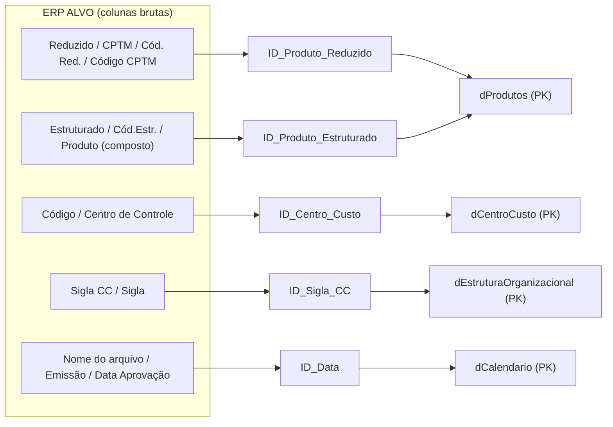
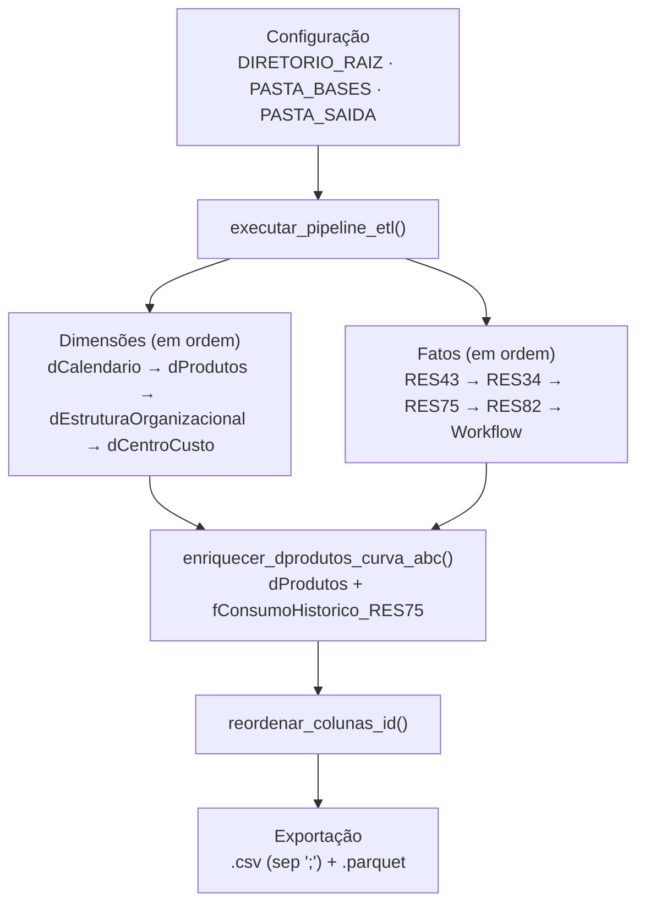

# 🔑 MVP II — DICIONÁRIO DE DADOS, LINHAGEM DO CÓDIGO E BIBLIOTECA DE MEDIDAS

> **Projeto:** Business Intelligence para Gestão de Estoque e Suprimentos — CPTM (ERP ALVO)  
> **Etapa:** MVP II — Rastreabilidade de Chaves, Linhagem do ETL e Camada Semântica (DAX)  
> **Instituição:** FATEC Logística • 4º Semestre • Disciplina API IV • Prof. Newton

---

## 📌 1. O que é este MVP

O [MVP I](./MVP_I.md) entregou o pipeline de ETL, o modelo Star Schema e a Curva ABC. O MVP II documenta **como e por que** cada decisão foi tomada, e entrega a camada de medidas que sustenta os painéis:

- **Rastreabilidade:** de qual arquivo e coluna do ERP ALVO nasceu cada chave `ID_*`, e qual regra a transformou.
- **Linhagem do código:** como o script `etl_cptm_powerbi.py` está organizado, função por função e tabela por tabela.
- **Decisões técnicas:** por que Calamine, Unpivot, Parquet, Star Schema e a exclusão do relatório RES47.
- **Biblioteca DAX:** as 32 medidas da tabela `_Medidas`, prontas para os dashboards.

> ℹ️ Contexto do projeto, objetivos, estrutura do repositório, descrição das bases, arquitetura Star Schema, matriz de relacionamentos, benchmarks e resultados da Curva ABC estão no **MVP I** e **não são repetidos aqui**. Quando necessário, esta página aponta para a seção correspondente.

### Mapa de leitura

| Seção | Pergunta que responde | Documento de apoio (`02_Documentacao/`) |
| :--- | :--- | :--- |
| [2. Dicionário de colunas ID](#-2-dicionário-de-colunas-id-e-rastreabilidade) | De onde veio cada chave e que tratamento recebeu? | `Dicionario_Colunas_ID_Processados_PowerBI` |
| [3. Linhagem do código Python](#-3-linhagem-do-código-python-etl_cptm_powerbipy) | Como o ETL está organizado e o que cada função faz? | `etl_cptm_powerbi.py` (raiz do projeto) |
| [4. Decisões técnicas](#-4-decisões-técnicas-complementares) | Por que essas tecnologias e escolhas de modelagem? | `Explicacao_Engine_Rust_Calamine`, `Explicacao_Unpivot_Melt`, `Explicacao_Formato_Parquet`, `Explicacao_Modelo_Star_Schema`, `Relacionamentos_PowerBI_CPTM`, `Explicacao_Uso_Arquivo_RES47` |
| [5. Biblioteca DAX](#-5-biblioteca-de-medidas-dax-_medidas) | Quais medidas existem e como criá-las? | `Guia_Medidas_DAX_CPTM` |

---

## 🔑 2. Dicionário de colunas ID e rastreabilidade

O MVP I apresenta as 5 chaves e a matriz de relacionamentos (seção 6). Aqui está o nível de detalhe por coluna: **21 colunas `ID_*`** distribuídas nas 9 tabelas.

### 2.1 Por que foi necessária uma engenharia de chaves

| Problema no ERP | Exemplo real | Tratamento |
| :--- | :--- | :--- |
| **Nomenclatura discrepante** | O mesmo código de material se chama `Reduzido` (cadastro), `CPTM` (RES43), `Cód. Red.` (RES34) e `Código CPTM` (RES75) | Unificação em `ID_Produto_Reduzido` |
| **Zeros à esquerda perdidos** | `'084467'` lido como `84467.0`; `'000033'` lido como `33` | Texto de 6 dígitos; alfanuméricos preservados (`'E006054'`) |
| **Máscara de pontos** | `'1.10.00.0.0'` lido como número decimal pelo Power Query | Texto imutável, preservado também pelo Parquet |
| **Textos compostos e caracteres ocultos** | `\n`, `\r`; `'1.03.01.01.00013-7 - PARAFUSO...'` | `strip` e `split` isolam apenas o código |
| **Chaves sem visibilidade** | Colunas de ligação perdidas entre dezenas de campos | `reordenar_colunas_id()` as leva para as primeiras posições |

### 2.2 Matriz consolidada de rastreabilidade

**Legenda:** **PK** = chave primária (lado 1) · **FK** = chave estrangeira (lado N) · **FK Aux.** = estrangeira auxiliar, sem relacionamento ativo, mantida para análise e conferência · **Secundária / Atributo** = identificador adicional da dimensão.

| Tabela Destino | Tipo | Coluna ID Criada | Arquivo de Origem (ERP) | Coluna de Origem | Chave | Regra de Transformação |
| :--- | :--- | :--- | :--- | :--- | :--- | :--- |
| `dCalendario` | Dimensão | `ID_Data` | Gerada dinamicamente | `pd.date_range` (2014–2030) | PK | `strftime('%Y-%m-%d')` |
| `dProdutos` | Dimensão | `ID_Produto_Reduzido` | `1. PROD__20260824.xlsx` | `Reduzido` | PK | `formatar_codigo_reduzido` (6 dígitos / `zfill`) |
| `dProdutos` | Dimensão | `ID_Produto_Estruturado` | `1. PROD__20260824.xlsx` | `Estruturado` | Secundária | `formatar_texto_limpo` |
| `dEstruturaOrganizacional` | Dimensão | `ID_Sigla_CC` | `0. Estrutura Organizacional_20260824.xlsx` | `Sigla CC` | PK | `formatar_texto_limpo` + desduplicação (159 siglas) |
| `dEstruturaOrganizacional` | Dimensão | `ID_Centro_Custo` | `0. Estrutura Organizacional_20260824.xlsx` | `Código Estruturado` | Atributo | `formatar_texto_limpo` |
| `dCentroCusto` | Dimensão | `ID_Centro_Custo` | `3. Centro de Custo_20260824.xlsx` | `Código` | PK | `formatar_texto_limpo`, preservando a máscara com pontos |
| `dCentroCusto` | Dimensão | `ID_Sigla_CC` | `3. Centro de Custo_20260824.xlsx` | `Sigla` | FK | `formatar_texto_limpo` (liga 1:N com `dEstruturaOrganizacional`) |
| `fPlanejamento_RES43` | Fato | `ID_Produto_Reduzido` | `2. RES43_*_20260824.xlsx` (3 arquivos) | `CPTM` (`skiprows=1`) | FK | `formatar_codigo_reduzido` |
| `fPlanejamento_RES43` | Fato | `ID_Produto_Estruturado` | `2. RES43_*_20260824.xlsx` (3 arquivos) | `Cód.Estr.` | FK Aux. | `formatar_texto_limpo` |
| `fPlanejamento_RES43` | Fato | `ID_Centro_Custo` | `2. RES43_*_20260824.xlsx` (3 arquivos) | `Centro de Controle` | FK Aux. | `formatar_texto_limpo` |
| `fPlanejamento_RES43` | Fato | `ID_Data` | Metadado do nome do arquivo | Data no nome (`YYYYMMDD`) | FK | `extrair_data_nome_arquivo` → `'2026-08-24'` |
| `fEstoque_Almoxarifado_RES34` | Fato | `ID_Produto_Reduzido` | `4. RES34_20260824.xlsx` | `Cód. Red.` | FK | `formatar_codigo_reduzido` |
| `fEstoque_Almoxarifado_RES34` | Fato | `ID_Produto_Estruturado` | `4. RES34_20260824.xlsx` | `Cód. Estr.` | FK Aux. | `formatar_texto_limpo` |
| `fEstoque_Almoxarifado_RES34` | Fato | `ID_Data` | Metadado do nome do arquivo | Data no nome (`YYYYMMDD`) | FK | `extrair_data_nome_arquivo` → data de corte do saldo |
| `fConsumoHistorico_RES75` | Fato | `ID_Produto_Reduzido` | `6. RES75_20260824.xlsx` | `Código CPTM` | FK | `formatar_codigo_reduzido` (antes do Unpivot) |
| `fConsumoHistorico_RES75` | Fato | `ID_Produto_Estruturado` | `6. RES75_20260824.xlsx` | `Produto Estruturado` | FK Aux. | `formatar_texto_limpo` |
| `fConsumoHistorico_RES75` | Fato | `ID_Centro_Custo` | `6. RES75_20260824.xlsx` | `Centro de Controle` | FK | `formatar_texto_limpo` (liga 1:N com `dCentroCusto`) |
| `fMovimentacoes_RES82` | Fato | `ID_Produto_Estruturado` | `7. RES82_20260825.xlsx` | `Produto` (composto) | FK | `split(' - ')[0].strip()` |
| `fMovimentacoes_RES82` | Fato | `ID_Data` | `7. RES82_20260825.xlsx` | `Emissão` | FK | `pd.to_datetime` → `dt.strftime('%Y-%m-%d')` |
| `fRequisicoes_Workflow` | Fato | `ID_Centro_Custo` | `8. Movimentações Materiais_*.xlsx` | `Centro de Controle` | FK | `split('-')[0].strip()` |
| `fRequisicoes_Workflow` | Fato | `ID_Data` | `8. Movimentações Materiais_*.xlsx` | `Data Aprovação` | FK | `pd.to_datetime` → `dt.strftime('%Y-%m-%d')` |

### 2.3 Casos especiais: do valor bruto à chave

| Caso | Valor bruto no ERP | Valor na chave | Tabela |
| :--- | :--- | :--- | :--- |
| Zeros à esquerda | `33` · `84467.0` | `000033` · `084467` | Todas com `ID_Produto_Reduzido` |
| Código alfanumérico | `E006054` | `E006054` (inalterado) | Todas com `ID_Produto_Reduzido` |
| Código estruturado concatenado | `1.03.01.01.00013-7 - PARAFUSO SEXTAVADO...` | `1.03.01.01.00013-7` | `fMovimentacoes_RES82` |
| Centro de controle concatenado | `6.06.1.1.02 - MANUTENCAO...` | `6.06.1.1.02` | `fRequisicoes_Workflow` |
| Data no nome do arquivo | `4. RES34_20260824.xlsx` | `2026-08-24` | `fEstoque_Almoxarifado_RES34`, `fPlanejamento_RES43` |
| Data em formato brasileiro | `30/09/2021` (`dayfirst=True`) | `2021-09-30` | `fMovimentacoes_RES82`, `fRequisicoes_Workflow` |
| Máscara hierárquica | `1.10.00.0.0` · `5.02.8.0` | Mantida como texto | `dCentroCusto` e fatos relacionadas |

### 2.4 Mapa de linhagem (coluna do ERP → chave → dimensão)



### 2.5 Auditoria de integridade: pontos de atenção

Todos os 11 relacionamentos estão ativos e foram criados automaticamente pelo Power BI. A tabela completa de match está no MVP I (seção 8.A); aqui ficam apenas as relações abaixo de 100%.

| Relacionamento | Match | Observação |
| :--- | :---: | :--- |
| `dProdutos[ID_Produto_Estruturado]` → `fMovimentacoes_RES82` | 99,1% | Única relação de produto baseada no código **estruturado**, extraído da coluna composta `Produto`; as demais usam o código reduzido |
| `dCalendario[ID_Data]` → `fRequisicoes_Workflow` | 99,9% | `ID_Data` deriva de `Data Aprovação`; datas ausentes ou inválidas viram nulo (`errors='coerce'`) e não encontram par no calendário |
| Demais 9 relacionamentos | 100,0% | — |

---

## 🐍 3. Linhagem do código Python (`etl_cptm_powerbi.py`)

### 3.1 Fluxo de execução



### 3.2 Requisitos e execução

| Item | Detalhe |
| :--- | :--- |
| **Bibliotecas** | `pandas`, `numpy`, `python-calamine` (engine de leitura) e `pyarrow` (gravação Parquet) |
| **Configuração** | Ajustar a constante `DIRETORIO_RAIZ` para o caminho local da pasta `CPTM/`; `PASTA_BASES`, `PASTA_DIMENSOES`, `PASTA_FATOS` e `PASTA_SAIDA` são derivadas dela |
| **Execução** | `python etl_cptm_powerbi.py` |
| **Saída** | `01_Bases_ERP/Processados_PowerBI/` (criada automaticamente se não existir) |
| **Consolidação multiarquivo** | Cada função lê **todos** os Excel da sua pasta (`.xlsx`, `.xls`, `.xlsm`), ignora temporários (`~$`) e concatena. Novas exportações do ERP colocadas na pasta são incorporadas na próxima execução |
| **Pasta vazia** | Levanta `FileNotFoundError` com o nome da pasta |
| **Falha em uma tabela** | Registra `[ERRO CRÍTICO]` e o pipeline segue com as demais; se `dProdutos` ou `fConsumoHistorico_RES75` falharem, a Curva ABC é ignorada |
| **Falha no Parquet** | Registra `[AVISO]` e o CSV da tabela ainda é salvo |
| **Colunas ausentes** | Cada `ID_*` só é criado se a coluna de origem existir no arquivo lido |

### 3.3 Funções auxiliares

| Função | Papel | Usada por |
| :--- | :--- | :--- |
| `obter_todos_arquivos_excel(pasta)` | Lista os Excel da pasta (ordenados, sem duplicatas e sem `~$`) | Todas as funções de tabela |
| `extrair_data_nome_arquivo(nome)` | Extrai `YYYYMMDD` do nome do arquivo e devolve `YYYY-MM-DD` | RES43, RES34 |
| `formatar_codigo_reduzido(val)` | Padroniza o código reduzido em 6 dígitos | `dProdutos`, RES43, RES34, RES75 |
| `formatar_texto_limpo(val)` | Sanitiza códigos estruturados, siglas e centros de custo | Dimensões, RES43, RES34, RES75 |
| `formatar_coluna_linha(val)` | Normaliza a coluna `LINHA` | `dEstruturaOrganizacional` |
| `reordenar_colunas_id(df)` | Move as colunas `ID_*` para o início (código no MVP I, seção 7.2) | Exportação de todas as tabelas |

```python
def formatar_codigo_reduzido(val) -> str:
    if pd.isna(val) or str(val).strip() == "" or str(val).lower() == "nan":
        return ""
    s = str(val).strip()
    if s.endswith(".0"):          # '84467.0' -> '84467'
        s = s[:-2]
    if s.isdigit():
        return s.zfill(6)         # '33' -> '000033'
    return s                      # alfanumérico, ex.: 'E006054'


def formatar_texto_limpo(val) -> str:
    if pd.isna(val) or val is None or str(val).lower() == "nan":
        return ""
    # \r removido, \n vira espaço, strip nas extremidades; os pontos são preservados
    return str(val).replace("\r", "").replace("\n", " ").strip()


def extrair_data_nome_arquivo(nome_arquivo: str) -> str:
    match = re.search(r'(\d{4})(\d{2})(\d{2})', nome_arquivo)
    if match:
        ano, mes, dia = match.groups()
        return f"{ano}-{mes}-{dia}"
    return None
```

> 🔎 `formatar_coluna_linha()` trata um caso específico da coluna `LINHA`: valores que contêm `2013` são gravados como `11 / 12 / 13`, e as barras são padronizadas com espaços (`'11 / 12 / 13'`).

### 3.4 Linhagem por tabela

Ordem de execução do orquestrador, pasta de origem (dentro de `01_Bases_ERP/`) e tratamentos específicos de cada função.

| # | Função → Tabela | Origem | Tratamentos específicos |
| :-: | :--- | :--- | :--- |
| 1 | `processar_dimensao_calendario` → `dCalendario` | Gerada por código | `pd.date_range` diário de 2014-01-01 a 2030-12-31 (6.209 dias). Deriva `Data`, `Ano`, `Mes_Num`, `Nome_Mes`, `Nome_Mes_Abrev`, `Ano_Mes`, `Ano_Mes_Num`, `Dia`, `Dia_Semana_Num`, `Nome_Dia_Semana`, `Trimestre`, `Trimestre_Nome`, `Semestre`, `Semana_Ano`, `Eh_Fim_De_Semana` e `Eh_Dia_Util` |
| 2 | `processar_dimensao_produtos` → `dProdutos` | `Dimensoes/01_Produtos` | Leitura `calamine` com `dtype=str`; `strip` em todas as células; cria `ID_Produto_Reduzido` e `ID_Produto_Estruturado`; descarta linhas sem código reduzido; `drop_duplicates` por `ID_Produto_Reduzido` mantendo a **última** ocorrência |
| 3 | `processar_dimensao_estrutura` → `dEstruturaOrganizacional` | `Dimensoes/02_Estrutura_Organizacional` | `dtype=str`; cria `ID_Centro_Custo` (de `Código Estruturado`) e `ID_Sigla_CC` (de `Sigla CC`); normaliza `LINHA`; descarta siglas vazias; `drop_duplicates` por `ID_Sigla_CC` mantendo a **primeira** |
| 4 | `processar_dimensao_centros_custo` → `dCentroCusto` | `Dimensoes/03_Centros_de_Custo` | Cria `ID_Centro_Custo` (de `Código`) e `ID_Sigla_CC` (de `Sigla`); converte `Inicial` e `Final` para data (`dayfirst=True`); `Ativo = True` quando `Final` está vazio; ordena com ativos primeiro e `drop_duplicates` por `ID_Centro_Custo` mantendo a **primeira** |
| 5 | `processar_fato_planejamento_res43` → `fPlanejamento_RES43` | `Fatos/RES43_Planejamento_Reposicao` | `skiprows=1` (cabeçalho do relatório na linha 1); quebras de linha nos nomes de coluna viram espaço; `Categoria_Consumo` definida pelo nome do arquivo (`Essencial`, `Estratégico` ou `Normal`, padrão); `ID_Data` vem do nome do arquivo |
| 6 | `processar_fato_estoque_res34` → `fEstoque_Almoxarifado_RES34` | `Fatos/RES34_Estoque_Almoxarifado` | `dtype=str`; `ID_Data` vem do nome do arquivo (data de corte do saldo) |
| 7 | `processar_fato_consumo_res75` → `fConsumoHistorico_RES75` | `Fatos/RES75_Consumo_PCA_Historico` | Cria os `ID_*` **antes** do Unpivot; detecta as colunas de ano por regex `\d{4}\s+(MOV\|PCA)`; mantém só as colunas essenciais; aplica `pd.melt` (seção 4.2); converte `Quantidade` para número (erros viram 0) e filtra `ID_Produto_Reduzido` vazio e `Quantidade > 0` |
| 8 | `processar_fato_movimentacoes_res82` → `fMovimentacoes_RES82` | `Fatos/RES82_Movimentacoes_Estoque` | `dtype=str`; `ID_Produto_Estruturado` por `split(' - ')`; `ID_Data` de `Emissão` (`errors='coerce'`, `dayfirst=True`); `drop_duplicates` pela coluna `Chave` mantendo a **última** |
| 9 | `processar_fato_requisicoes_workflow` → `fRequisicoes_Workflow` | `Fatos/Requisicoes_Workflow` | `dtype=str`; `ID_Centro_Custo` por `split('-')[0]`; `ID_Data` de `Data Aprovação` (`errors='coerce'`, `dayfirst=True`); `drop_duplicates` pela coluna `Número` mantendo a **última** |

### 3.5 Curva ABC: o que a função completa acrescenta ao MVP I

O MVP I (seção 7.4) mostra a lógica central. A função `enriquecer_dprodutos_curva_abc()` acrescenta estes comportamentos de robustez:

- Trabalha sobre uma **cópia** do consumo e força `Quantidade` para numérico.
- Se o consumo total for zero, classifica tudo como `Sem Consumo`.
- Faz o `merge` à esquerda apenas com as colunas necessárias e preenche: `Classe_ABC = "Sem Consumo"`, `Pct_Consumo_Acumulado = 0.0` e `Quantidade_Consumida_Total = 0.0`. O `Rank_Consumo` permanece vazio para produtos sem consumo.
- Imprime no log a contagem por classe (`value_counts`).

> 🔎 **Nota de rastreabilidade:** a agregação soma `Quantidade` por `ID_Produto_Reduzido` sobre **todas** as linhas de `fConsumoHistorico_RES75`, ou seja, os indicadores `MOV` e `PCA`, sem filtro por `Tipo_Indicador`.

---

## 🧠 4. Decisões técnicas complementares

Os resultados de cada tecnologia (benchmarks, ganhos de armazenamento, código do `pd.melt`) estão no MVP I. Esta seção registra o **raciocínio** por trás delas.

### 4.1 Engine Rust `calamine`

O MVP I (seção 7.1) traz o benchmark de ~15x. O que explica esse ganho:

| Engine | Natureza | Limitação no contexto da CPTM |
| :--- | :--- | :--- |
| `openpyxl` (padrão `.xlsx`) | Python puro: descompacta o ZIP e faz o *parsing* de cada tag XML em memória | Degrada em planilhas largas e longas, como `dProdutos` (56.830 linhas × 138 colunas), e eleva o risco de estouro de memória |
| `xlrd` (padrão `.xls`) | Leitor de binários legados | Descontinuado para formatos modernos e lento |
| **`calamine`** (via `python-calamine`) | Escrito em **Rust**, exposto como engine nativa do `pd.read_excel()` | — |

**Por que o Rust é mais rápido:**

- **Código de máquina nativo:** sem máquina virtual nem camada de interpretação.
- **Memória sem *garbage collector*:** o modelo de posse (*ownership*) aloca e libera memória sem pausar a execução.
- **Leitura direta de fluxos binários:** converte o conteúdo do Excel em estruturas de dados sem criar objetos Python intermediários.

**Benefício para a gestão:** os painéis podem ser atualizados em segundos sempre que novas planilhas saírem do ERP ALVO, o pipeline escala com o histórico sem exigir hardware maior e os tipos permanecem íntegros (`dtype=str`).

### 4.2 Unpivot com `pd.melt`

O MVP I (seção 7.3) mostra o resultado em formato longo e as medidas DAX. Aqui está o **problema de origem** e o mapeamento dos parâmetros.

**Estrutura bruta do RES75 (formato matricial, valores ilustrativos):**

| Código CPTM | Descrição | Centro de Controle | 2014 MOV | 2014 PCA | 2015 MOV | 2015 PCA | ... | 2026 PCA |
| :--- | :--- | :--- | ---: | ---: | ---: | ---: | :---: | ---: |
| `084467` | SAPATO DE FREIO | `1.10.00.0.0` | 150 | 180 | 200 | 200 | ... | 250 |
| `000033` | ROLAMENTO | `1.10.00.0.0` | 0 | 0 | 12 | 15 | ... | 20 |

**Por que esse formato não serve ao modelo:**

1. **Incompatível com o Star Schema:** o ano está embutido no nome de 26 colunas diferentes, e não em um valor filtrável.
2. **Medidas DAX frágeis:** somar o consumo exigiria encadear coluna por coluna (`'2014 MOV' + '2015 MOV' + ...`), impedindo filtros temporais dinâmicos.
3. **Desperdício de espaço:** a matriz carrega muitas células com `0` ou nulas, que ocupam disco e memória sem informação.

**Como o pipeline parametriza o `pd.melt`:**

| Parâmetro | Valor no pipeline |
| :--- | :--- |
| `id_vars` | `colunas_id`: os 3 `ID_*`, `Código CPTM`, `Produto Estruturado`, `Centro de Controle`, `Classe`, `Grupo`, `Subgrupo` e `Unidade de Medida` |
| `value_vars` | `colunas_anos`: as colunas que casam com o regex `\d{4}\s+(MOV\|PCA)` (26 colunas) |
| `var_name` | `"Ano_Tipo"` (ex.: `'2014 MOV'`), depois dividida em `Ano` (`'2014'`) e `Tipo_Indicador` (`'MOV'` ou `'PCA'`) |
| `value_name` | `"Quantidade"` |

Duas consequências práticas:

- **Corte temporal pela coluna `Ano`:** `fConsumoHistorico_RES75` não possui `ID_Data`, então o filtro por período do consumo usa o campo `Ano` da própria tabela.
- **Base da Curva ABC:** o formato longo permite o `groupby("ID_Produto_Reduzido")["Quantidade"].sum()` usado no cálculo de Pareto.

### 4.3 Apache Parquet: como consumir no Power BI

As vantagens do formato (tipos preservados, até 10x mais rápido, até 85% menor) estão no MVP I (seção 7.5). O uso prático:

1. No Power BI Desktop, use **Obter dados → Parquet** (ou o conector de **Pasta**) apontando para `01_Bases_ERP/Processados_PowerBI/`.
2. Selecione **prioritariamente os arquivos `.parquet`**, para ter o desempenho máximo e a integridade dos tipos.
3. Revise os tipos das colunas numéricas e de data conforme a seção 5.2. As fatos RES43, RES34, RES82 e Workflow são lidas com `dtype=str` no ETL, então valores numéricos e datas precisam ser tipados no Power Query.

### 4.4 Star Schema no Power BI Desktop

O diagrama, as vantagens do VertiPaq e a matriz de relacionamentos estão no MVP I (seções 5 e 6). Complementos de implementação:

**Disposição visual do modelo**

| Camada | Tabelas (da esquerda para a direita) |
| :--- | :--- |
| **Topo: dimensões (lado 1)** | `dCalendario` → `dProdutos` → `dEstruturaOrganizacional` → `dCentroCusto` |
| **Base: fatos (lado N)** | `fMovimentacoes_RES82`, `fConsumoHistorico_RES75`, `fEstoque_Almoxarifado_RES34`, `fPlanejamento_RES43`, `fRequisicoes_Workflow` |

**Configurações do modelo:** relacionamentos 1:N unidirecionais (Dimensão ➔ Fato), `dCalendario` marcada como **Tabela de Data** (*Time Intelligence*) e tabela dedicada `_Medidas` (seção 5).

**Impacto logístico:** o gestor de almoxarifado cruza, no mesmo visual, o estoque (`fEstoque_Almoxarifado_RES34`), o consumo real (`fConsumoHistorico_RES75`) e a criticidade do item (`dProdutos[Classe_ABC]`).

### 4.5 O relatório RES47 e por que ele não virou tabela

`5. RES47_20260824.xlsx` (`Fatos/RES47_Estoque_Consumo`) foi usado **exclusivamente como diagnóstico e validação cruzada contábil**. Ele foi deliberadamente excluído do pipeline final e não gerou arquivo em `Processados_PowerBI`.

**Conteúdo do arquivo (posição em 24/08/2026, nível empresa):**

| Nº | Coluna | Significado operacional |
| :-: | :--- | :--- |
| 1 | `Código Reduzido` | Identificador sequencial numérico do material |
| 2 | `Código Estruturado` | Classificação categórica do produto |
| 3 | `Descrição` | Descrição textual resumida do material |
| 4 | `Tipo Consumo` | Classificação de demanda (Normal, Essencial etc.) |
| 5 | `Utilização` | Finalidade de aplicação operacional / manutenção |
| 6 | `Unid. Medida` | Unidade física de controle (UN, PC, KG, M etc.) |
| 7 | `Quantidade` | Saldo físico total consolidado da companhia |
| 8 | `Custo Médio` | Custo médio ponderado unitário |
| 9 | `Valor Total` | Valor imobilizado (Quantidade × Custo Médio) |
| 10 | `Última Movimentação` | Data da transação mais recente do item |
| 11 | `Último Consumo` | Data da última saída para aplicação |

**Os 4 pilares da exclusão** (critérios de modelagem multidimensional, Ralph Kimball):

1. **Redundância de grão com o RES34:** o RES47 traz saldos consolidados da empresa, sem informar onde o item está. O `fEstoque_Almoxarifado_RES34` detalha por almoxarifado; manter os dois duplicaria a métrica de saldo.
2. **Série temporal vs. data estática:** o RES47 resume o histórico de saídas a uma única data (`Último Consumo`). O `fConsumoHistorico_RES75` cobre 2014–2026 por centro de controle e indicador, e o `fMovimentacoes_RES82` registra cada transação, o que permite sazonalidade, médias móveis e Curva ABC reais.
3. **Viés de amostra:** conforme o manual oficial da CPTM (`Descrição dos Arquivos Disponibilizados para o Projeto.pdf`), o RES47 só lista itens com saldo físico positivo. Itens zerados ou em ruptura, justamente os mais críticos para reposição, ficam ocultos.
4. **Governança em DAX:** grãos conflitantes (empresa vs. almoxarifado) sobre o mesmo domínio geram risco de contagem dupla em agregações como `SUM(Valor_Total)`, além de consumir memória no VertiPaq.

**Comparativo com as tabelas adotadas:**

| Dimensão de análise | RES47 | Tabela adotada | Benefício no Power BI |
| :--- | :--- | :--- | :--- |
| Saldo e valor em estoque | Sintético (empresa inteira) | `fEstoque_Almoxarifado_RES34` | Filtrar saldos por unidade física |
| Histórico de consumo | Apenas data da última saída | `fConsumoHistorico_RES75` | Curva ABC, tendências e médias móveis |
| Movimentação física | Apenas data da última transação | `fMovimentacoes_RES82` | Rastreio completo de entradas, saídas e devoluções |
| Planejamento / reposição | Ausente | `fPlanejamento_RES43` | Cobertura de estoque e risco de ruptura |
| Gestão de requisições | Ausente | `fRequisicoes_Workflow` | SLA e lead time por centro de custo |

**Contribuição efetiva do RES47 ao projeto:**

- **Auditoria de totais:** serviu de gabarito para conferir se a soma dos saldos de todos os almoxarifados do RES34 coincide com o saldo geral reportado.
- **Validação da classificação de consumo:** permitiu conferir o enquadramento Normal vs. Essencial frente aos parâmetros do RES43.
- **Rigor metodológico:** em BI corporativo, saber escolher as fontes de maior granularidade e descartar bases intermediárias redundantes é tão importante quanto integrá-las.

---

## 📐 5. Biblioteca de medidas DAX (`_Medidas`)

Arquivo: `03_Modelos_PBIX/CPTM.pbix` · Origem: tabelas de `01_Bases_ERP/Processados_PowerBI`.

### 5.1 Por que uma tabela dedicada de medidas

Todas as regras de negócio e KPIs ficam em uma tabela desvinculada de dados (`_Medidas`), o que garante:

1. **Governança:** cálculos centralizados, sem dispersão entre fatos e dimensões.
2. **Performance:** medidas calculadas sob demanda pelo VertiPaq, conforme o contexto de filtro.
3. **Reutilização:** medidas básicas alimentam as complexas (giro, cobertura, aderência).

### 5.2 Pré-requisito: tipos de dados no Power Query

Antes de inserir as fórmulas, confirme em **Transformar Dados** que as colunas abaixo estão tipadas.

| Tabela fato | Coluna | Tipo correto |
| :--- | :--- | :--- |
| `fEstoque_Almoxarifado_RES34` | `Saldo Atual` | Número Inteiro ou Decimal |
| `fEstoque_Almoxarifado_RES34` | `Saldo Total` | Número Inteiro ou Decimal |
| `fEstoque_Almoxarifado_RES34` | `Valor Unit` | Número Decimal Fixo |
| `fEstoque_Almoxarifado_RES34` | `Valor Total` | Número Decimal Fixo (Moeda) |
| `fConsumoHistorico_RES75` | `Quantidade` | Número Decimal |
| `fConsumoHistorico_RES75` | `Ano` | Texto ou Número Inteiro |
| `fPlanejamento_RES43` | `Saldo` | Número Decimal |
| `fPlanejamento_RES43` | `Consumo Médio Mensal` | Número Decimal |
| `fPlanejamento_RES43` | `Quantidade Necessária p/ Compra` | Número Decimal |
| `fPlanejamento_RES43` | `Previsão $` | Número Decimal Fixo (Moeda) |
| `fMovimentacoes_RES82` | `Qtde.` | Número Decimal |
| `fMovimentacoes_RES82` | `Valor Unit.` | Número Decimal Fixo |
| `fMovimentacoes_RES82` | `Valor Total` | Número Decimal Fixo (Moeda) |
| `fRequisicoes_Workflow` | `Data`, `Data Aprovação`, `Data Início Separação`, `Data Fim Separação`, `Data Entrega` | Data/Hora |

> 💡 Se uma coluna com decimais brasileiros (vírgula decimal, ponto de milhar) falhar na conversão, use **Alterar Tipo → Usando Localidade...**, com tipo `Número Decimal` e localidade `Português (Brasil)`.

### 5.3 Criação da tabela `_Medidas`

1. **Página Inicial → Inserir Dados**, nomeie a tabela como `_Medidas` e clique em **Carregar**.
2. Crie a primeira medida nessa tabela.
3. Oculte ou exclua a coluna vazia `Coluna1`. O ícone da tabela muda para uma **calculadora**, indicando que ela virou a tabela oficial de medidas.
4. Em **Modo de Exibição de Modelo → Propriedades**, preencha a **Pasta de exibição** de cada medida:

```text
_Medidas/
├── 01 - Cadastros & Base
├── 02 - Estoque & Almoxarifado
├── 03 - Consumo Histórico & Curva ABC
├── 04 - Indicadores Chave (Giro & Cobertura)
├── 05 - Planejamento & Reposição (RES43)
├── 06 - Workflow & SLA de Requisições
└── 07 - Movimentações de Estoque (RES82)
```

### 5.4 Catálogo das 32 medidas

> Os exemplos do MVP I (`Consumo_Realizado_Qtd`, `Pct_Aderencia_PCA`) correspondem às medidas **12** e **15** abaixo, já com a nomenclatura final da biblioteca.

<details>
<summary><b>📁 Pasta 01 — Cadastros & Base (medidas 1 a 5)</b></summary>

```dax
// 1. Total Itens Cadastrados | Formato: #,##0
// Materiais cadastrados no ERP ALVO (56.830)
Total Itens Cadastrados =
COUNTROWS(dProdutos)

// 2. Itens com Consumo Histórico | Formato: #,##0
// Produtos com ao menos uma saída no histórico (14.626)
Itens com Consumo Histórico =
CALCULATE(
    COUNTROWS(dProdutos),
    dProdutos[Classe_ABC] IN {"Classe A", "Classe B", "Classe C"}
)

// 3. Itens Sem Giro | Formato: #,##0
// Itens sem nenhuma saída: potencial de descarte, alienação ou desativação cadastral (42.204)
Itens Sem Giro =
CALCULATE(
    COUNTROWS(dProdutos),
    dProdutos[Classe_ABC] = "Sem Consumo"
)

// 4. % Itens Sem Giro | Formato: 0.0%
// Proporção do catálogo sem giro recente (74,3%)
% Itens Sem Giro =
DIVIDE([Itens Sem Giro], [Total Itens Cadastrados], 0)

// 5. Total Centros de Custo Ativos | Formato: #,##0
// Unidades organizacionais consumidoras e ativas
Total Centros de Custo Ativos =
CALCULATE(
    COUNTROWS(dCentroCusto),
    dCentroCusto[Ativo] = TRUE()
)
```

</details>

<details>
<summary><b>📁 Pasta 02 — Estoque & Almoxarifado / RES34 (medidas 6 a 11)</b></summary>

```dax
// 6. Estoque Físico Atual (Qtd) | Formato: #,##0
// Saldo físico nos almoxarifados na fotografia da base
Estoque Físico Atual (Qtd) =
SUM(fEstoque_Almoxarifado_RES34[Saldo Atual])

// 7. Estoque Valorizado Total (R$) | Formato: R$ #,##0.00
// Capital financeiro imobilizado em peças e materiais sobressalentes
Estoque Valorizado Total (R$) =
SUM(fEstoque_Almoxarifado_RES34[Valor Total])

// 8. Custo Médio Unitário em Estoque (R$) | Formato: R$ #,##0.00
// Custo ponderado por unidade armazenada
Custo Médio Unitário em Estoque (R$) =
DIVIDE([Estoque Valorizado Total (R$)], [Estoque Físico Atual (Qtd)], 0)

// 9. Estoque Valorizado - Classe A (R$) | Formato: R$ #,##0.00
// Valor em estoque alocado nos 28 produtos da Curva A
Estoque Valorizado - Classe A (R$) =
CALCULATE(
    [Estoque Valorizado Total (R$)],
    dProdutos[Classe_ABC] = "Classe A"
)

// 10. % Capital Imobilizado na Classe A | Formato: 0.0%
// Concentração do investimento nos itens estratégicos da operação
% Capital Imobilizado na Classe A =
DIVIDE([Estoque Valorizado - Classe A (R$)], [Estoque Valorizado Total (R$)], 0)

// 11. Total de Almoxarifados Ativos | Formato: #,##0
// Pontos de estocagem operacionais (ex.: Altino, Lapa)
Total de Almoxarifados Ativos =
DISTINCTCOUNT(fEstoque_Almoxarifado_RES34[Almoxarifado])
```

</details>

<details>
<summary><b>📁 Pasta 03 — Consumo Histórico & Curva ABC / RES75 (medidas 12 a 17)</b></summary>

```dax
// 12. Consumo Realizado Histórico (Qtd) | Formato: #,##0
// Saídas físicas efetivas do estoque (indicador MOV)
Consumo Realizado Histórico (Qtd) =
CALCULATE(
    SUM(fConsumoHistorico_RES75[Quantidade]),
    fConsumoHistorico_RES75[Tipo_Indicador] = "MOV"
)

// 13. Previsão PCA (Qtd) | Formato: #,##0
// Meta de consumo da Pesquisa de Consumo Anual (indicador PCA)
Previsão PCA (Qtd) =
CALCULATE(
    SUM(fConsumoHistorico_RES75[Quantidade]),
    fConsumoHistorico_RES75[Tipo_Indicador] = "PCA"
)

// 14. Desvio Consumo vs PCA (Qtd) | Formato: +#,##0;-#,##0;0
// Valores positivos indicam consumo acima da previsão
Desvio Consumo vs PCA (Qtd) =
[Consumo Realizado Histórico (Qtd)] - [Previsão PCA (Qtd)]

// 15. % Aderência ao PCA | Formato: 0.0%
// Acurácia da previsão de demanda
% Aderência ao PCA =
DIVIDE([Consumo Realizado Histórico (Qtd)], [Previsão PCA (Qtd)], 0)

// 16. Consumo Médio Mensal Histórico (Qtd) | Formato: #,##0.0
// Base para cobertura e estoque de segurança
Consumo Médio Mensal Histórico (Qtd) =
VAR MesesDistintos = DISTINCTCOUNT(dCalendario[Ano_Mes_Num])
RETURN
    DIVIDE([Consumo Realizado Histórico (Qtd)], MesesDistintos, 0)

// 17. Consumo Classe A (Qtd) | Formato: #,##0
// Volume consumido pelos itens do topo de Pareto
Consumo Classe A (Qtd) =
CALCULATE(
    [Consumo Realizado Histórico (Qtd)],
    dProdutos[Classe_ABC] = "Classe A"
)
```

</details>

<details>
<summary><b>📁 Pasta 04 — Indicadores Chave: Giro & Cobertura (medidas 18 a 20)</b></summary>

```dax
// 18. Cobertura de Estoque (Meses) | Formato: 0.0 "meses"
// Quantos meses o estoque atual atende mantendo o consumo médio histórico, sem novas compras
Cobertura de Estoque (Meses) =
VAR CMM = [Consumo Médio Mensal Histórico (Qtd)]
RETURN
    IF(
        CMM > 0,
        DIVIDE([Estoque Físico Atual (Qtd)], CMM, BLANK()),
        BLANK()
    )

// 19. Giro de Estoque | Formato: 0.00 "vezes"
// Frequência de renovação do estoque; quanto maior, menor o capital parado
Giro de Estoque =
DIVIDE(
    [Consumo Realizado Histórico (Qtd)],
    [Estoque Físico Atual (Qtd)],
    0
)

// 20. Classificação Status de Cobertura | Formato: Texto
// Segmenta itens em risco de desabastecimento ou com excesso de estoque
Classificação Status de Cobertura =
VAR Cob = [Cobertura de Estoque (Meses)]
RETURN
    SWITCH(
        TRUE(),
        ISBLANK(Cob), "Sem Giro Recente",
        Cob < 1.0, "🔴 Crítico (< 1 mês - Risco Ruptura)",
        Cob <= 3.0, "🟢 Adequado (1 a 3 meses)",
        Cob <= 6.0, "🟡 Atenção (3 a 6 meses)",
        "⚪ Sobrestoque (> 6 meses)"
    )
```

</details>

<details>
<summary><b>📁 Pasta 05 — Planejamento & Reposição / RES43 (medidas 21 a 24)</b></summary>

```dax
// 21. Necessidade Total de Compra (Qtd) | Formato: #,##0
// Demanda calculada pelo relatório de planejamento de reposição
Necessidade Total de Compra (Qtd) =
SUM(fPlanejamento_RES43[Quantidade Necessária p/ Compra])

// 22. Valor Total Previsto p/ Compra (R$) | Formato: R$ #,##0.00
// Orçamento estimado para as necessidades de reposição
Valor Total Previsto p/ Compra (R$) =
SUM(fPlanejamento_RES43[Previsão $])

// 23. Itens em Ponto de Pedido | Formato: #,##0
// Materiais distintos que atingiram o nível de reabastecimento obrigatório
Itens em Ponto de Pedido =
CALCULATE(
    DISTINCTCOUNT(fPlanejamento_RES43[ID_Produto_Reduzido]),
    fPlanejamento_RES43[Quantidade Necessária p/ Compra] > 0
)

// 24. Compra Necessária - Estratégico (R$) | Formato: R$ #,##0.00
// Orçamento para peças estratégicas (manutenção pesada e via permanente)
Compra Necessária - Estratégico (R$) =
CALCULATE(
    [Valor Total Previsto p/ Compra (R$)],
    fPlanejamento_RES43[Categoria_Consumo] = "Estratégico"
)
```

</details>

<details>
<summary><b>📁 Pasta 06 — Workflow & SLA de Requisições (medidas 25 a 29)</b></summary>

```dax
// 25. Total de Requisições (RMs) | Formato: #,##0
// Solicitações formais de materiais registradas pelas áreas usuárias
Total de Requisições (RMs) =
DISTINCTCOUNT(fRequisicoes_Workflow[Número])

// 26. RMs Atendidas e Entregues | Formato: #,##0
// Pedidos com ciclo logístico finalizado pela entrega física
RMs Atendidas e Entregues =
CALCULATE(
    [Total de Requisições (RMs)],
    NOT(ISBLANK(fRequisicoes_Workflow[Data Entrega]))
)

// 27. Lead Time Médio de Atendimento (Dias) | Formato: 0.0 "dias"
// Tempo entre a emissão da requisição e o recebimento das peças
Lead Time Médio de Atendimento (Dias) =
AVERAGEX(
    FILTER(
        fRequisicoes_Workflow,
        NOT(ISBLANK(fRequisicoes_Workflow[Data])) &&
        NOT(ISBLANK(fRequisicoes_Workflow[Data Entrega]))
    ),
    DATEDIFF(fRequisicoes_Workflow[Data], fRequisicoes_Workflow[Data Entrega], DAY)
)

// 28. Tempo Médio de Separação (Horas) | Formato: 0.0 "horas"
// Eficiência da equipe do almoxarifado no picking
Tempo Médio de Separação (Horas) =
AVERAGEX(
    FILTER(
        fRequisicoes_Workflow,
        NOT(ISBLANK(fRequisicoes_Workflow[Data Início Separação])) &&
        NOT(ISBLANK(fRequisicoes_Workflow[Data Fim Separação]))
    ),
    DATEDIFF(fRequisicoes_Workflow[Data Início Separação], fRequisicoes_Workflow[Data Fim Separação], MINUTE) / 60
)

// 29. % RMs Atendidas no Prazo (SLA <= 3 Dias) | Formato: 0.0%
// Nível de serviço logístico (OTD, On-Time Delivery)
% RMs Atendidas no Prazo (SLA <= 3 Dias) =
VAR RMsNoPrazo =
    CALCULATE(
        [Total de Requisições (RMs)],
        FILTER(
            fRequisicoes_Workflow,
            NOT(ISBLANK(fRequisicoes_Workflow[Data])) &&
            NOT(ISBLANK(fRequisicoes_Workflow[Data Entrega])) &&
            DATEDIFF(fRequisicoes_Workflow[Data], fRequisicoes_Workflow[Data Entrega], DAY) <= 3
        )
    )
RETURN
    DIVIDE(RMsNoPrazo, [RMs Atendidas e Entregues], 0)
```

</details>

<details>
<summary><b>📁 Pasta 07 — Movimentações de Estoque / RES82 (medidas 30 a 32)</b></summary>

```dax
// 30. Total de Transações Físicas | Formato: #,##0
// Registros de entrada, saída, transferência e devolução
Total de Transações Físicas =
COUNTROWS(fMovimentacoes_RES82)

// 31. Valor Total Movimentado (R$) | Formato: R$ #,##0.00
// Fluxo financeiro transacionado nos almoxarifados
Valor Total Movimentado (R$) =
SUM(fMovimentacoes_RES82[Valor Total])

// 32. Valor de Saídas para Manutenção (R$) | Formato: R$ #,##0.00
// Subtotal consumido pelas equipes de manutenção de frotas e via
Valor de Saídas para Manutenção (R$) =
CALCULATE(
    [Valor Total Movimentado (R$)],
    SEARCH("SAÍDA", fMovimentacoes_RES82[Tipo Lancto.], 1, 0) > 0 ||
    SEARCH("SAIDA", fMovimentacoes_RES82[Tipo Lancto.], 1, 0) > 0
)
```

</details>

### 5.5 Validação dos cartões principais

Após inserir as medidas, confira os valores esperados no Power BI Desktop:

| Medida | Valor esperado |
| :--- | :---: |
| `Total Itens Cadastrados` | 56.830 |
| `Itens Sem Giro` | 42.204 |
| `% Itens Sem Giro` | 74,3% |
| `Itens com Consumo Histórico` | 14.626 (28 na Classe A) |
| `Total de Almoxarifados Ativos` | 18 |
| `Total de Requisições (RMs)` | 67.331 |

---

## 🏁 6. Status e próximos passos

Com o MVP II, as chaves são rastreáveis até a coluna do ERP, o código do ETL está documentado função por função, as decisões de modelagem estão justificadas e a camada semântica (32 medidas) está pronta para consumo. O próximo passo é a **Etapa 3**: construção dos dashboards sobre este modelo, conforme os painéis planejados no MVP I (seção 9).

---

<sub>FATEC Logística — 4º Semestre | Modelo Star Schema e Engenharia de Dados em Python</sub>
